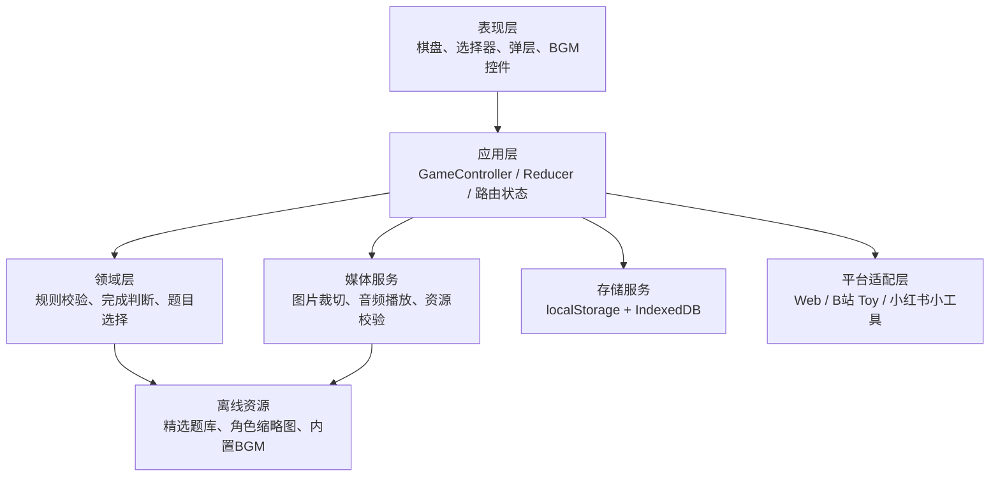
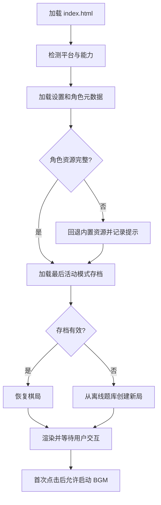
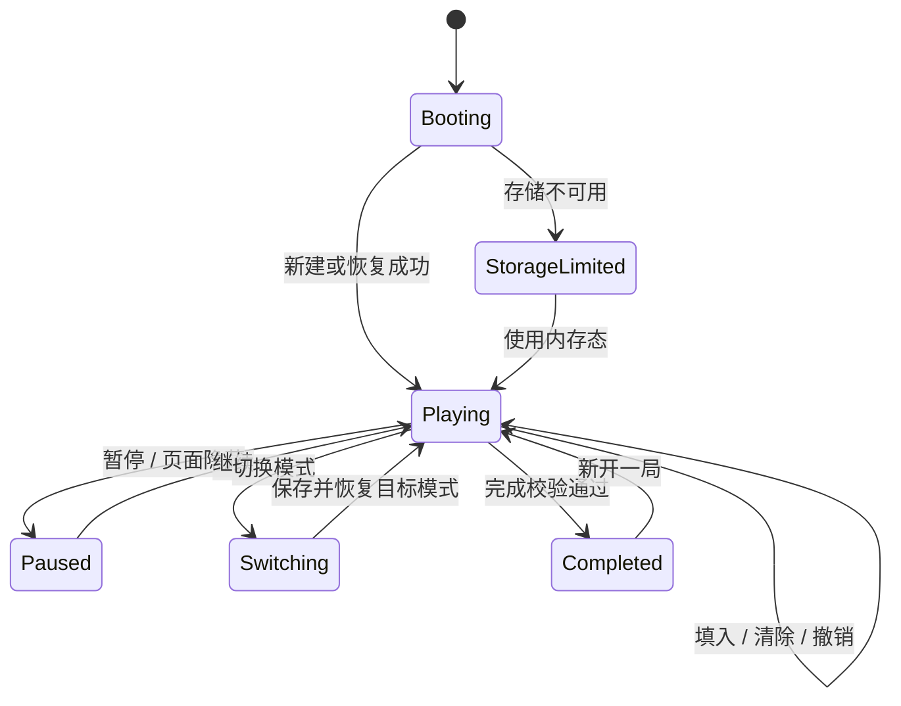

# 虚拟歌手数独——顶层功能设计文档

> 文档版本：v0.1  
> 设计状态：开发基线  
> 最后更新：2026-10-03

## 1. 范围与目标

本文定义首个可发布版本的功能边界、模块划分、核心数据、状态流、平台适配和验收标准。目标是用同一套离线 H5 核心支持 B站 Toy 与小红书小工具，并保证数独规则、角色映射和自动存档在两个平台上的行为一致。

### 1.1 首发范围（P0）

- 简易模式：4×4 数独、4 个角色图标。
- 高难模式：9×9 数独、9 个角色图标。
- 选格、填入、替换、清除、撤销、冲突提示、完成校验。
- 4 人版和 9 人版角色图标自定义上传、裁切、排序、恢复默认。
- 内置 BGM 切歌、播放/暂停、音量记忆。
- 能力允许的平台支持本地 BGM 导入。
- 简易/高难各自自动保存一份最近棋局，并在下次进入时恢复。
- 全离线运行，不依赖 CDN、远程接口或在线题库。
- B站 Toy 与小红书小工具的独立构建和发布检查。

### 1.2 首发不包含

- 登录、账号体系、跨设备同步。
- 在线排行榜、好友对战、多人联机。
- 广告、支付或订阅。
- 在线曲库、在线图片搜索、云端上传。
- AI 解题或联网生成题目。
- 用户素材对外分享或上传到服务器。

“提示”“候选笔记”“每日挑战”“成绩统计”可作为后续 P1 功能，不阻塞 P0。

## 2. 项目现状与设计结论

### 2.1 已有资源

- `公式服头像` 中现有 9 张接近正方形的角色头像，可覆盖 4 人与 9 人默认预设。
- `sudoku-exchange-puzzle-bank` 提供 9×9 的 easy、medium、hard、diabolical 四档题库，题目保证唯一解，数据集许可证为公共领域。
- 原始 9×9 文本题库合计体积很大，不适合直接打入小工具离线包。
- 当前没有 4×4 题库、运行时代码、BGM 素材或正式 9 人角色集。

### 2.2 必须执行的结论

1. 构建期从 9×9 原始题库抽取、去重、校验并生成小型运行时题库；原始 `.txt` 不进入发布包。
2. 4×4 题目由构建期生成器产生，并用求解器验证唯一解。
3. 内置角色源图在构建期人工设定焦点并压缩为方形头像；原始大图不进入发布包。
4. 9 人默认预设已齐全；发布前逐张确认素材授权与小尺寸辨识度，不用重复角色冒充不同数值。
5. 自定义图标和 BGM 属于二进制用户数据，使用 IndexedDB；棋局和偏好使用 localStorage。
6. 核心功能采用 DOM/CSS 渲染，不使用 WebGL，不让视觉效果影响低端设备稳定性。

## 3. 总体架构



架构原则：

- 领域层只处理数值 0–9，不知道角色图片、平台或 DOM。
- UI 通过 `IconSet` 把数值映射为角色图标；更换图片不改变题目和存档。
- 所有平台差异通过能力检测和 `PlatformAdapter` 收口，业务组件不直接调用平台对象。
- 状态变化通过单一 action 流更新，便于撤销、自动保存和测试。
- 发布产物不含内联脚本、行内事件和运行时网络请求。

## 4. 建议目录与构建产物

建议后续实现采用如下逻辑结构；实际框架可调整，但模块职责不能混合：

```text
src/
├─ app/                    # 启动、页面状态、事件协调
├─ domain/
│  ├─ board.ts            # 棋盘模型与行列宫计算
│  ├─ validator.ts        # 冲突、完成、解校验
│  ├─ puzzle-picker.ts    # 离线题目选择与去重
│  └─ reducer.ts          # 游戏动作与撤销记录
├─ services/
│  ├─ storage.ts          # 存档、迁移、失败降级
│  ├─ media.ts            # BGM 与可播放性检测
│  ├─ image-pipeline.ts   # 图片读取、裁切、缩放
│  └─ platform.ts         # 平台能力接口
├─ ui/                    # 棋盘、选择器、工具条、弹层
├─ data/                  # 构建期生成的小题库清单
└─ assets/                # 压缩头像、内置音频、SVG

scripts/
├─ build-puzzle-bank.*    # 从原始题库抽样并校验
├─ generate-4x4.*         # 生成唯一解 4×4 题目
└─ optimize-icons.*       # 生成运行时头像

dist/
├─ toy/                   # B站 Toy 静态产物
└─ xhs/                   # 小红书小工具静态产物
```

最终脚本必须打包为面向 ES2017 / Chrome 61 的经典脚本（IIFE 或等价形式），`index.html` 通过相对路径引用，不使用 `type="module"`、动态 import 或外部 CDN。

## 5. 核心领域模型

### 5.1 数值约定

- `0`：空格。
- `1..4`：简易模式的四个角色。
- `1..9`：高难模式的九个角色。
- 数独算法只读写数值；角色名称、图片和颜色由展示映射提供。

### 5.2 Puzzle

```ts
type GameMode = 'simple-4x4' | 'hard-9x9'

interface Puzzle {
  id: string
  mode: GameMode
  size: 4 | 9
  boxRows: 2 | 3
  boxCols: 2 | 3
  givens: number[]       // 长度 16 或 81，0 表示空格
  solution: number[]     // 唯一解；仅用于本地校验
  difficulty: string
  source: 'generated-4x4' | 'sudoku-exchange'
}
```

约束：

- `givens` 和 `solution` 长度必须等于 `size × size`。
- 每行、每列、每宫都包含 1..size 且不重复。
- `givens` 中的非零值必须与 `solution` 对应位置一致。
- 题目在构建期用独立求解器确认恰好一个解。

### 5.3 GameState

```ts
interface GameState {
  schemaVersion: 1
  mode: GameMode
  puzzleId: string
  givens: number[]
  solution: number[]
  entries: number[]
  selectedIndex: number | null
  history: GameActionSnapshot[]
  elapsedMs: number
  mistakes: number
  status: 'playing' | 'paused' | 'completed'
  startedAt: string
  updatedAt: string
}
```

存档中保留题面和解，而不只保存 `puzzleId`，从而避免版本更新删题后无法恢复。单机游戏把解保存在本地是可接受的；若未来加入排行榜，服务端不得信任客户端完成结果。

### 5.4 IconSet

```ts
interface IconSlot {
  value: number
  label: string
  source: 'builtin' | 'user'
  assetKey: string
  crop: { x: number; y: number; scale: number }
}

interface IconSet {
  schemaVersion: 1
  size: 4 | 9
  slots: IconSlot[]
  updatedAt: string
}
```

- `assetKey` 指向内置相对路径或 IndexedDB 中的用户资源键。
- `slots` 必须覆盖 1..size，缺失时不能开始新局。
- 更换 `IconSet` 后，正在进行的棋局立即使用新图标，但数值和答案不变。

### 5.5 AudioTrack

```ts
interface AudioTrack {
  id: string
  title: string
  source: 'builtin' | 'user'
  assetKey: string
  mimeType: string
  size: number
  durationMs?: number
}
```

用户音频只保存经过浏览器可播放性验证且未超过体积限制的文件；不进行格式转换。

## 6. 游戏规则与动作

### 6.1 基本校验

对任意待填数值 `v`：

1. 当前格不是预置格。
2. 当前行不存在另一个 `v`。
3. 当前列不存在另一个 `v`。
4. 当前宫不存在另一个 `v`。

规则冲突与答案错误是不同概念：

- “规则冲突”可立即从当前棋盘判断。
- “答案错误”需要与 `solution` 比较。
- 简易模式默认同时提示二者；高难模式默认只提示规则冲突，完成时再做答案校验。

### 6.2 动作集合

| Action | 作用 | 是否写撤销栈 | 是否触发保存 |
| --- | --- | ---: | ---: |
| `SELECT_CELL` | 选择格子 | 否 | 否 |
| `PLACE_VALUE` | 填入或替换角色 | 是 | 是 |
| `CLEAR_CELL` | 清除玩家输入 | 是 | 是 |
| `UNDO` | 恢复上一步棋盘 | 否，消费一项 | 是 |
| `PAUSE` / `RESUME` | 暂停或继续 | 否 | 是 |
| `NEW_GAME` | 替换当前模式棋局 | 清空 | 是 |
| `SWITCH_MODE` | 保存当前并加载另一模式 | 否 | 是 |
| `APPLY_ICON_SET` | 更新角色映射 | 否 | 是，保存设置 |
| `COMPLETE_GAME` | 锁定结果与用时 | 否 | 是，立即落盘 |

撤销栈仅记录棋盘内容变化，建议上限 100 步，防止存档无限增大。

### 6.3 完成条件

仅当以下条件同时满足时完成：

- 无空格；
- 无行、列、宫冲突；
- `entries` 与 `solution` 全部一致。

完成判断必须由领域层一次性计算，不能依赖 UI 动画或 DOM 状态。

## 7. 题库策略

### 7.1 4×4

构建期流程：

1. 生成一个合法完整解。
2. 通过行、列、宫、数字的等价变换产生不同解盘。
3. 逐格挖空；每次挖空后运行求解器，只有仍保持唯一解才保留。
4. 按预置数量和求解步骤划分难度。
5. 去重后输出至少 100 道简易题。

运行时只随机抽题，不在首屏执行大量生成和唯一解搜索。

### 7.2 9×9

原始数据每行格式为“哈希、81 位题面、难度值”。构建脚本应：

1. 分别读取 easy、medium、hard 和 diabolical 四个源文件。
2. 解析第二字段为 81 位题面，第三字段为难度。
3. 源文件名是难度分类的权威来源；每个文件独立固定种子抽样，保证构建可复现。
4. 去重并验证题面格式、唯一解和来源许可证信息。
5. 生成保留四个独立分组的紧凑经典脚本；每个源文件首发选取 1,000 道，共 4,000 道。

界面将四个源文件直接映射为“简单 easy.txt、中等 medium.txt、困难 hard.txt、魔鬼 diabolical.txt”。运行时不把题目合并后重新推断难度。每个源文件独立使用本地洗牌袋：一轮中不重复，全部用完后再重置；每档最近 20 个 `puzzleId` 用于跨轮避重。

## 8. 自动存档设计

### 8.1 存储分工

| 数据 | 存储 | 原因 |
| --- | --- | --- |
| 两种模式的 GameState | localStorage | 小、同步、启动时快速读取 |
| 当前模式、音量、辅助设置 | localStorage | 体积小 |
| IconSet 元数据 | localStorage | 体积小，便于迁移 |
| 自定义头像二进制 | IndexedDB | 避免 Base64 撑大 localStorage |
| 自定义 BGM 二进制 | IndexedDB | 支持较大 Blob |

建议键名：

```text
vs-sudoku:game:simple:v1
vs-sudoku:game:hard:v1
vs-sudoku:settings:v1
vs-sudoku:icons:4:v1
vs-sudoku:icons:9:v1
```

### 8.2 保存时机

- 每次 `PLACE_VALUE`、`CLEAR_CELL`、`UNDO` 后 200–300 ms 防抖保存。
- `visibilitychange` 变为 hidden、`pagehide`、暂停、模式切换、完成时立即保存。
- BGM 播放进度不写入棋局；只保存曲目、播放偏好和音量。
- 写入失败不能阻止继续游戏，但需显示持续可见的未保存提示。

### 8.3 恢复与迁移

启动流程：

1. 读取设置和最后活动模式。
2. 读取对应 `GameState`。
3. 校验版本、数组长度、预置格不可变性、值域和题面一致性。
4. 有效则恢复；无效则备份可解析的旧值到诊断记录并创建新局。
5. 以后升级 schema 时通过纯函数逐版迁移，不在读取时直接就地修改原值。

本地容器数据不保证永久存在，产品文案不能承诺跨设备或永久保存。

## 9. 图片处理与图标配置

### 9.1 处理管线

```text
用户点击上传
→ 文件类型 / 体积校验
→ createImageBitmap 或 Image 解码
→ 裁切预览
→ Canvas 输出 256×256
→ 编码 WebP，失败则 JPEG/PNG
→ 写入 IndexedDB 临时键
→ 元数据提交成功后替换正式键
→ 删除旧资源
```

资源替换采用“先写新文件、再切元数据、最后删旧文件”的顺序，避免中途失败导致槽位丢图。Blob URL 仅用于临时预览，用完必须 `URL.revokeObjectURL()`。

### 9.2 限制

- 输入格式：PNG、JPEG、WebP。
- 建议输入上限：5 MiB/张。
- 输出尺寸：256×256。
- 输出目标：优先控制在 150 KiB/张以内。
- 同一模式的全部角色必须有可读资源后才允许应用。

## 10. BGM 服务

### 10.1 播放器职责

- 维护内置曲目和用户曲目队列。
- 播放、暂停、上一首、下一首、循环和音量。
- 处理自动播放拒绝、解码失败、页面隐藏、音频中断。
- 不向游戏 reducer 写入每秒播放位置，避免高频存档。

### 10.2 导入规则

- 入口必须由用户点击触发。
- 建议单文件上限 8 MiB，数量上限 5 首；额度不足时要求用户先删除旧曲目。
- 使用文件 MIME、扩展名和 `audio.canPlayType()` 做初筛，再以实际 `loadedmetadata` / `canplay` 作为最终验证。
- 不支持的音频给出可理解错误，不尝试 WASM 或在线转码。
- 自定义曲目使用 IndexedDB 保存，加载时创建 Blob URL，切歌或退出时释放。

### 10.3 平台降级

- B站 Toy / 浏览器：运行时能力检测通过后开放音频文件导入。
- 小红书小工具：系统文件选择能力仅支持图片和视频，因此不提供自定义音频导入；仍可播放包内 BGM。
- 任意平台若音频 API 不可用，BGM 模块整体降级为静音，数独主流程必须正常。

## 11. 平台适配层

### 11.1 接口

```ts
interface PlatformCapabilities {
  platform: 'web' | 'bilibili-toy' | 'xiaohongshu-minitool'
  canPickImage: boolean
  canPickAudio: boolean
  canPersistBlob: boolean
  canUseBuiltInAudio: boolean
}

interface PlatformAdapter {
  capabilities(): PlatformCapabilities
  onVisibilityChange(handler: (visible: boolean) => void): () => void
  getSafeAreaInsets(): SafeAreaInsets
}
```

能力以实际对象和行为检测为准，不通过 UA 字符串猜测。

### 11.2 B站 Toy

- 运行在 `/toy/<slug>/` 子路径，所有脚本、样式、图片、音频使用相对路径。
- 构建基础路径设为 `./`，禁止 `/assets/...` 根绝对路径。
- 单页应用优先 DOM 视图切换或 hash 路由；本项目页面少，建议不引入路由库。
- 上传只包含构建产物，不带源码、`node_modules`、source map、原始题库或 `toy.yaml`。
- 发布前检查预览链接，再提交审核；审核通过前不视为正式上线。
- 首发只使用本地存档，不依赖云存储/排行榜额度。

### 11.3 小红书小工具

- 产物为纯本地离线 H5 ZIP，`index.html` 位于 ZIP 根目录。
- 所有资源相对引用，禁止联网请求、外部 CDN、iframe、Worker、WebAssembly、动态代码执行。
- 脚本必须外置并使用经典脚本，不使用行内事件。
- JavaScript 构建目标为 ES2017 / Chrome 61；新 Web API 必须能力检测并局部降级。
- CSS 提供 Chrome 61 基线，不把 Flex `gap`、`aspect-ratio`、`clamp()`、动态视口单位作为唯一实现。
- ZIP 硬上限按 10 MiB 控制，体验目标不超过 2 MiB；具体上线前以平台当前门禁再次核对。
- 安全区使用 `var(--safe-area-inset-*, env(safe-area-inset-*, 0px))`。
- 无网络条件下，题库、图标和内置 BGM 必须全部随包提供。

### 11.4 平台功能矩阵

| 功能 | B站 Toy | 小红书小工具 | 降级策略 |
| --- | --- | --- | --- |
| 4×4 / 9×9 游戏 | 支持 | 支持 | 无 |
| 自动存档 | 本地支持 | 本地支持 | 存储失败时临时游玩 |
| 图片上传 | 能力检测后支持 | 支持图片选择 | 失败时保留旧图 |
| 内置 BGM | 支持 | 支持包内媒体时启用 | 不可用则静音 |
| 自定义 BGM 导入 | 能力检测后支持 | 不支持 | 隐藏入口并说明 |
| 网络题库 | 不使用 | 不允许 | 构建期离线精选 |
| 云同步 / 排行榜 | 首发不使用 | 首发不使用 | 后续分平台扩展 |

## 12. 运行时启动流程



首屏加载只做必要配置、一个模式存档和当前图标集读取；另一模式存档、BGM列表和设置弹层资源可在空闲时加载。

## 13. 状态机



页面隐藏时至少停止计时器、动画和音频。恢复页面后仍保持暂停层，由用户主动继续，避免后台时间计入用时。

## 14. 性能预算

### 14.1 发布包

- 小红书最终 ZIP 不超过 10 MiB，目标不超过 2 MiB。
- 原始题库、原始全身立绘、构建配置和 source map 不进入产物。
- 运行时题库目标控制在 100 KiB 以内。
- 9 张内置头像目标合计不超过 600 KiB。
- 内置 BGM 应控制数量、时长和码率；若无法在 2 MiB 体验目标内提供，优先减少曲目或缩短音频，而不是牺牲游戏资源。

### 14.2 运行时

- 棋盘最多 81 个格子，不需要虚拟列表或 Canvas。
- 动画只使用 transform 和 opacity，避免每帧读取布局。
- 页面隐藏时停止计时刷新和动画；计时基于时间戳差值，不依赖每秒累加的定时器准确性。
- 图片裁切和编码只在用户确认上传时执行，不占用游戏主循环。
- 不使用 WebGL、Worker 或 WASM。

## 15. 错误处理

| 错误 | 用户表现 | 系统处理 |
| --- | --- | --- |
| 存档 JSON 损坏 | 提示旧进度无法恢复 | 忽略棋局，保留有效设置，创建新局 |
| localStorage 写满 | 常驻未保存提示 | 继续内存态，减少历史长度后可重试一次 |
| IndexedDB 不可用 | 禁用自定义素材持久化 | 内置图标和内置 BGM 仍可用 |
| 图片格式/解码失败 | 槽位显示错误说明 | 保留旧图，不修改配置 |
| 音频无法播放 | 曲目显示“不可播放” | 自动暂停并切换静音 |
| 题库条目非法 | 用户无感 | 跳过该题并记录；全部失败则给出恢复页 |
| 脚本/资源路径错误 | 发布门禁阻断 | 不允许进入平台发布流程 |

不得通过无限重试掩盖错误。存储、图片和音频操作最多自动重试一次，随后要求用户操作。

## 16. 安全、隐私与内容合规

- 不采集账号、设备标识、通讯录、位置或剪贴板数据。
- 不发起网络请求，不上传用户的角色图片、BGM或棋局。
- 文件选择必须由用户手势触发，只读取用户明确选择的文件。
- 文件名只用于显示，进入存储前生成内部 ID，不把文件名拼接成路径或 HTML。
- 所有用户文字用 `textContent` 渲染，不直接拼接到 `innerHTML`。
- 发布前确认角色立绘、角色名、BGM和应用封面的使用权及平台审核要求。
- 如后续加入分享图片，必须在本地 Canvas 生成，并确保平台能力与素材授权允许。

## 17. 测试策略

### 17.1 单元测试

- 4×4、9×9 行列宫索引计算。
- 冲突判断、不可修改预置格、完成条件。
- 题库解析、值域、唯一解验证。
- reducer 每个 action 的前后状态和撤销行为。
- 存档序列化、校验、迁移和损坏恢复。
- 角色映射在更换图标后不改变数值。

### 17.2 集成测试

- 填入三步后刷新，盘面、用时和撤销历史恢复。
- 简易进行中切换高难，再切回简易，原局不丢失。
- 完成后刷新仍保持完成状态，不重复计时。
- 上传 4 人/9 人头像，重启后映射和裁切结果一致。
- 导入、切歌、删除用户 BGM 后无 Blob URL 泄漏。
- localStorage 或 IndexedDB 被拒绝时仍可完成一局。

### 17.3 平台验收

- B站 Toy：子路径加载无 404，刷新和预览正常，所有资源为相对路径。
- 小红书小工具：ZIP 根目录存在 `index.html`，无外部请求、内联脚本、module、Worker、WASM 或禁用 API。
- PC 模拟器和至少一台 Android 真机、一台 iOS 真机完成核心流程。
- 320 px 窄屏、常见手机纵屏、横屏和安全区设备不遮挡底栏。
- 未完成真机测试前，发布记录必须明确标记“兼容性/性能未实测”。

## 18. P0 验收标准

1. 玩家可完成至少一局 4×4 和一局 9×9，所有题目满足标准数独约束并有唯一解。
2. 棋盘中每个数值均显示对应角色图标，映射在一局内稳定。
3. 4 人版与 9 人版都能独立保存自定义图标；图片失败不破坏原配置。
4. BGM 可播放/暂停、切歌和调音量；支持的平台可导入本地音频，小红书端不会展示无效上传入口。
5. 每次有效落子后自动保存；关闭并重新进入后恢复最近未完成进度。
6. 简易和高难模式互相切换不会覆盖对方存档。
7. 所有功能在断网状态下可用；开发者工具的网络面板无业务请求。
8. B站 Toy 和小红书小工具各自产物通过结构、路径、能力和体积门禁。
9. `公式服头像` 中 9 张默认素材完成显示、体积与授权检查。
10. README 或发布记录中列明未实测项、素材授权状态和已知平台降级。

## 19. 建议实施顺序

1. 建立数独领域模型、求解器、校验器和两类离线题库。
2. 实现纯数字版 4×4/9×9 棋盘、选择器、模式切换和完成流程。
3. 接入角色映射、内置缩略图和上传裁切管线。
4. 实现双模式自动存档、迁移和异常恢复。
5. 接入 BGM 播放器，再按平台能力开放自定义导入。
6. 建立 Toy / 小红书双构建产物和静态门禁。
7. 完成响应式、可访问性、真机验证和素材/版权审核。

## 20. 参考与变更核对

- B站 Toy 平台介绍：<https://www.bilibili.com/toy/intro>
- B站 Toy 发布指南（发布时以在线版本为准）：<https://www.bilibili.com/toy/publish/guide>
- 小红书小程序运行环境（用于了解端内多内核运行差异）：<https://miniapp.xiaohongshu.com/doc/DC096131>
- 仓库题库说明：`sudoku-exchange-puzzle-bank/README.md`
- 小红书小工具的 ZIP、CSP、端能力和 Chrome 61 约束以实际发布环境提供的当前规范为准；平台能力可能更新，发版前必须重新核对。
